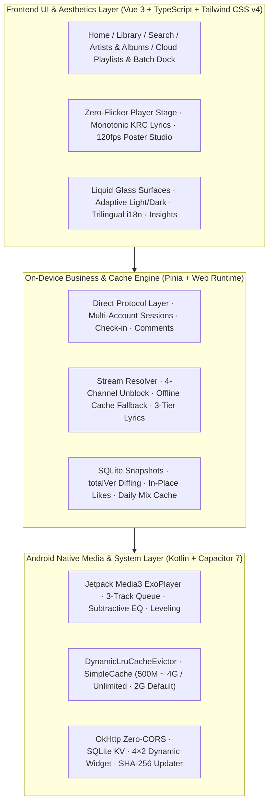

<div align="center">


# MELUNE · 弥音

[简体中文](./README.md) · **English** · [繁體中文](./README.zh-TW.md)

### Music fades in time, yet echoes linger on.
*Where Music Becomes Memory.*

Minimalist & Ad-Free · iOS 26 Liquid Glass Craftsmanship · Native Media3 Audio Engine & Configurable 2 GB Offline Cache · Trilingual Open-Source Android Music Client

<p>
  <a href="https://github.com/xhd2005/puretone/releases/latest">
    
  </a>
  <a href="https://github.com/xhd2005/puretone/actions">
    
  </a>
  <a href="https://www.gnu.org/licenses/gpl-3.0">
    
  </a>
  
  
</p>

[📥 Download Latest APK](https://github.com/xhd2005/puretone/releases/latest) · [✨ Core Features](#features) · [🏗️ Architecture](#architecture) · [❓ Getting Started & FAQ](#install) · [🙏 Special Thanks](#thanks) · [⚖️ Compliance & Disclaimer](#disclaimer)

</div>

---

## 🌙 Brand Philosophy

> **Mi (弥)** is lingering resonance — fullness and sound rippling quietly beyond time.  
> **Yin (音)** is melody and emotion — a private sanctuary uniquely your own.  
> MELUNE hopes to give every melody a space of its own, where every emotion finds resonance.  
> **MELUNE** (*Melody* × *Lune*) — **Music fades in time, yet echoes linger on.**

MELUNE is built around a restrained, audio-first philosophy: zero ads, zero algorithmic feeds, zero relay servers — returning the entire screen and listening flow purely to music.

---

<a id="features"></a>

## ✨ Core Features

### At a Glance

| 🎧 Native Audio Engine | 💾 Smart Cache & Offline | 🎵 Discovery, Lyrics & Studio | 💎 Craftsmanship & Compatibility |
| --- | --- | --- | --- |
| Media3 3-track lookahead queue | Configurable **2 GB** 5-tier cache | Zero-flicker monotonic KRC lyrics | iOS 26 Liquid Glass aesthetics |
| Cosine-eased track transitions | Offline cached audio playback | 120fps 5-template 1080p posters | Adaptive Light/Dark & seamless splash |
| Volume Leveling & Zero-Clip EQ | Version-checked 0ms playlists | 4-mode comments, threads & likes | Android 10–17 (incl. Legacy WebView) |
| Parallel 4-channel source matcher | Split audio & snapshot storage | Artists, albums & cloud playlists | Cold-start auto-update + SHA-256 check |

---

### 1. 🎧 Listening Experience & Native Audio Engine
- **Jetpack Media3 3-Track Native Lookahead Queue**: Pre-resolves upcoming tracks directly into `ExoPlayer`'s native playlist for zero-drop screen-off playback, instant 0ms Bluetooth headset skipping, and automatic recovery across outdoor cellular dropouts.
- **Smooth Track Transition Fade**: Single-engine cosine-eased track-end fade-out and gentle entry (`Off` / `1.5s` / `3s` / `5s`), plus soft 220ms pause/resume ramps with zero battery overhead.
- **Volume Leveling & Zero-Clip Subtractive EQ**: Native Android `LoudnessEnhancer` balances quiet vintage masters against modern loud tracks; all 5 EQ presets (`Flat`, `Vocal`, `Bass`, `Night`, `Live`) stay strictly `<= 0 dB` with 70ms duck / 120ms ramp transitions so mid-song preset switching never clips or pops.
- **Parallel 4-Channel Unblock & Source Pinning**: Concurrently scores full-length original audio alternatives for restricted or trial tracks, with manual auditioning and per-track persistent source pinning.

### 2. 💾 Configurable 2 GB Cache, Offline Playback & 0ms Instant Playlists
- **5-Tier Live-Adjustable Audio Cache (2 GB Default)**: Powered by a custom `DynamicLruCacheEvictor` atop Media3 `SimpleCache` (`500 MB / 1 GB / 2 GB (Default) / 4 GB / Unlimited`). Lowering the limit trims the least-recently-played audio automatically while keeping favorite tracks hot on disk.
- **Seamless Offline / Weak-Network Playback**: In airplane mode, subways, or when online resolution times out, MELUNE verifies local `SimpleCache` completeness and streams cached tracks instantaneously with zero network bytes (`本地缓存` badge).
- **Version-Checked Instant Playlists**: Local SQLite snapshots store KuGou's cloud `totalVer` and track count — opening *Liked Songs* or 1,000+ track playlists takes **0ms and 0 network requests** whenever unchanged, while automatically syncing remote changes and offering a one-tap top-bar Refresh button.
- **In-Place Local Mutations & Instant Home**: Liking/unliking songs or adding/removing playlist tracks updates local snapshots in-place and stamps the new `totalVer` instead of wiping the cache. Home *Daily Mix* and playlist lists hydrate instantaneously from SQLite, with transparent split storage breakdown and independent clearing in Settings.

### 3. 🎵 Zero-Flicker Lyrics, 120fps Poster Studio & Community
- **Persistent Artwork Stage & Monotonic Word-by-Word KRC Engine**: Eliminates cover and lyric playback flicker; features a 3-tier lyric fallback pipeline (*KuGou KRC + Translation → NetEase Bilingual LRC → LRCLIB*), 3 font sizes, per-song sync offset (`±0.5s / ±1s`), and chorus highlight (`song_climax`) markers on the scrub bar.
- **120fps Direct-Canvas Lyric Poster Studio**: 5 curated 1080p templates (*Glass*, *Vinyl*, *Polaroid*, *Cinema*, *Moonlit*) backed by LRU artwork caching and smooth offscreen blur, with translation toggle, date stamp, gallery export, and native system sharing.
- **Deep Library Exploration & Cloud Playlist Management**: Rich Artist Profiles (stats, full bio modal, follow/unfollow, hot/latest filtering, multi-artist picker), Album pages, 4-tab search, multi-category Trending Charts, plus full cloud playlist creation, editing, privacy toggle, deletion, collection, and a bottom takeover batch dock.
- **Track Details & 4-Mode Comments**: Featured / Top / Latest / Hotword tabs, clean deduplicated floor-reply threads, 100+ native emoji mappings, real-time comment likes, and signed-in replies.

### 4. 💎 Liquid Glass Aesthetics, Trilingual Support & Engineering Quality
- **Seamless Moonlit Splash & Adaptive Light/Dark Theme**: Matches Android's `#0B1336` launch window seamlessly into the poetic splash with zero white flash; adaptive Light / Dark / System theme guarded by an automated `.dark` root visibility CSS gate, plus iOS Screen-Time-style listening insights and multi-account VIP check-in calendars.
- **Android 16/17 Official Live Updates & 4×2 Dynamic Home Widget**: Properly separates `EXTRA_COLORIZED` from `requestPromotedOngoing` for modern Live Updates, paired with a dynamic album-colored 4×2 home widget with live favorite syncing.
- **Cold-Start Auto-Update with Multi-Mirror Failover**: Automatically checks for updates after launch (distinguishing **Later** vs **Ignore vX.Y.Z**), backed by multi-mirror failover, jsDelivr CDN, custom mirror prefixes, and mandatory on-device APK SHA-256 verification.
- **Android 10–17 Legacy WebView Pipeline & Full i18n**: A custom build-time CSS compatibility plugin unwraps `@layer`, `:where()`, `oklch()`, and modern shorthands for Chromium 80+ WebViews (e.g. Android 11 / ColorOS 11.1), alongside full Simplified Chinese, Traditional Chinese, and English localization.

---

<a id="architecture"></a>

## 🏗️ Pure On-Device 3-Layer Architecture

MELUNE runs **100% locally on your device** — all API traffic, caching, and persistence happen directly between your phone and upstream services with zero developer-operated relay servers:



---

<a id="install"></a>

## 📥 Installation, Upgrades & FAQ

### Quick Install
1. Download **`MELUNE-v2.4.9-release.apk`** from [GitHub Releases](https://github.com/xhd2005/puretone/releases/latest).
2. Install directly — all previous versions of MELUNE / PureTone support **100% lossless overwrite upgrades**.
3. Enable **Notifications** and disable aggressive background battery restrictions in Android Settings for reliable screen-off playback.

### Frequently Asked Questions

<details>
<summary><strong>1. Will upgrading wipe my login session, playlists, or listening stats?</strong></summary>

No. MELUNE permanently preserves its package ID (`com.xhd2005.puretone`) and 50-year release certificate (SHA-256 `89c6ca074542578f6faf341ad1a8f57cbac72f1c89e954fbd3f15756d203a723`) across local and CI builds. Overwrite-installing preserves 100% of accounts, insights, EQ settings, and caches.
</details>

<details>
<summary><strong>2. How do "Liked Songs" and large playlists open instantaneously without re-syncing?</strong></summary>

Since `v2.4.9`, local SQLite snapshots record KuGou's cloud version (`totalVer`) and track count. Opening an unchanged playlist takes **0ms and 0 network calls**, and local likes/additions mutate snapshots in-place. Tap the top-bar **Refresh** icon anytime to pull changes made on other devices.
</details>

<details>
<summary><strong>3. How does the 2 GB offline cache work, and does clearing it erase my snapshots?</strong></summary>

Go to *Account & Settings → Preferences → **Smart Audio Cache*** to pick `500M / 1G / 2G (Default) / 4G / Max`. Played tracks are cached automatically and play offline seamlessly when disconnected. Audio Cache and Playlist/Home Snapshots are managed independently, so clearing either never touches your login accounts, stats, or preferences.
</details>

<details>
<summary><strong>4. Why isn't MELUNE whitelisted on OEM capsules like vivo OriginOS Atomic Island?</strong></summary>

Certain OEM ROMs enforce hard-coded commercial package whitelists for status-bar music capsules. MELUNE remains strictly open-source compliant and never spoofs third-party package IDs. Add the **MELUNE 4×2 Dynamic Home Widget** for dynamic album-colored controls and heart syncing.
</details>

<details>
<summary><strong>5. How can I migrate my listening stats and EQ settings to a new phone safely?</strong></summary>

Open *Preferences → **Stats & Preferences JSON Backup*** and tap **Export** to copy your charts, EQ, audio quality, per-song lyric offsets, and pinned sources as plain JSON (**all login cookies and tokens are strictly excluded**). Paste into **Restore** on your new device.
</details>

---

<a id="thanks"></a>

## 🙏 Special Thanks

MELUNE stands on the shoulders of remarkable open-source engineering and generous real-device testers. Deep gratitude to every project, maintainer, and community member below:

### 🎵 Music Ecosystem & Design Inspiration

| Project / Community | License | Contribution & Inspiration |
| --- | :---: | --- |
| [**MakcRe/KuGouMusicApi**](https://github.com/MakcRe/KuGouMusicApi) | MIT | Comprehensive client-side KuGou Concept API protocol and signing references powering MELUNE's direct on-device architecture. |
| [**EchoMusic**](https://github.com/EchoMusicApp) | GPL-3.0 | Inspiring mobile player ergonomics, artist profile choreography, and restrained music-first aesthetics. |
| [**LRCLIB**](https://github.com/tranxuanthang/lrclib) | MIT | Free community synced-lyrics database serving as the international third-tier lyric fallback. |
| [**UnblockNeteaseMusic**](https://github.com/UnblockNeteaseMusic/server) | LGPL-3.0 | Inspired multi-source concurrent candidate scoring and seamless alternative stream matching. |

### 🤖 Android Native & Audio Foundation

| Project | License | Role in MELUNE |
| --- | :---: | --- |
| [**Android Jetpack Media3**](https://github.com/androidx/media) | Apache-2.0 | Drives native `ExoPlayer`, `MediaSessionService`, 3-track lookahead queueing, dynamic LRU `SimpleCache`, and lock-screen/Bluetooth controls. |
| [**Capacitor**](https://github.com/ionic-team/capacitor) | MIT | Modern Web-to-Native runtime and custom Kotlin plugin bridge uniting UI craftsmanship with native Android audio. |
| [**OkHttp**](https://github.com/square/okhttp) | Apache-2.0 | Powers the zero-CORS native HTTP bridge, ExoPlayer upstream data source, and multi-mirror SHA-256 APK downloader. |
| [**Kotlin**](https://github.com/JetBrains/kotlin) & [**kotlinx.coroutines**](https://github.com/Kotlin/kotlinx.coroutines) | Apache-2.0 | Powers all native Android services, asynchronous artwork color extraction, and low-overhead disk I/O. |
| [**AndroidX**](https://github.com/androidx/androidx) | Apache-2.0 | `AppCompat`, `Core-KTX`, and `SplashScreen` enabling Android 10–17 edge-to-edge safe insets and zero-flash launch transitions. |
| [**Google Guava**](https://github.com/google/guava) | Apache-2.0 | Supplies `ListenableFuture` and `ImmutableList` primitives for Media3 `MediaSession` callbacks and custom notification controls. |

### 🎨 Frontend UI, Tooling & Cryptography

| Project | License | Role in MELUNE |
| --- | :---: | --- |
| [**Vue 3**](https://github.com/vuejs/core) | MIT | Powers reactive views, persistent GPU multi-pane sheets, and the zero-flicker NowPlaying stage. |
| [**Vue Router**](https://github.com/vuejs/router) | MIT | Paired with `KeepAlive` and directional push/pop transitions for fluid mobile navigation. |
| [**Pinia**](https://github.com/vuejs/pinia) | MIT | Clean state management for accounts, playback queues, cloud playlists, listening insights, and preferences. |
| [**Tailwind CSS v4**](https://github.com/tailwindlabs/tailwindcss) | MIT | Drives the Liquid Glass utility design system alongside our custom Android 11 legacy WebView downlevel plugin. |
| [**TypeScript**](https://github.com/microsoft/TypeScript) | Apache-2.0 | End-to-end static type safety across business logic, native bridges, and protocol parsers. |
| [**Vite**](https://github.com/vitejs/vite) & [**Vitest**](https://github.com/vitest-dev/vitest) | MIT | Fast production bundling, build-time CSS safety gates, and 93 automated core regression tests. |
| [**Iconify**](https://github.com/iconify/iconify) & [**Tabler Icons**](https://github.com/tabler/tabler-icons) | MIT | Crisp, tree-shaken stroke iconography across the entire interface. |
| [**pako**](https://github.com/nodeca/pako) | MIT | Pure client-side zlib decompression for KuGou encrypted KRC word-by-word lyrics. |
| [**crypto-js**](https://github.com/brix/crypto-js) & [**node-forge**](https://github.com/digitalbazaar/forge) | MIT / BSD-3-Clause | Cross-platform cryptographic signing and device identity primitives. |
| [**node-qrcode**](https://github.com/soldair/node-qrcode) | MIT | On-device QR code rendering for quick scan login flows. |
| [**big-integer**](https://github.com/peterolson/BigInteger.js) & [**Axios**](https://github.com/axios/axios) | Unlicense / MIT | Arbitrary-precision arithmetic and the native zero-CORS HTTP adapter shim. |

### 🌐 Distribution Mirrors & Real-Device Community

| Credit | Support & Contribution |
| --- | --- |
| [**GitHub Actions**](https://github.com/features/actions) & [**jsDelivr**](https://github.com/jsdelivr/jsdelivr) | Automated signed APK CI builds, `updates/latest.json` publishing, and global CDN manifest acceleration. |
| **Open-Source GitHub Mirror Ecosystem** | Mainland acceleration nodes (`ghfast`, `gh-proxy`, `akams`, `ghproxy`) paired with mandatory client-side SHA-256 verification for reliable updates. |
| **Real-Device Testers & Early Users** | Heartfelt thanks to everyone who tested builds on real **Android 11 / ColorOS 11.1**, **vivo OriginOS**, and **Xiaomi HyperOS** devices and reported feedback on Dark Mode, flicker, animations, threaded comments, and caching! |

---

## 🛠️ Local Development & Build

```bash
# 1. Install dependencies
pnpm install

# 2. Typecheck, run all 93 frontend unit tests & build web bundle
pnpm typecheck && pnpm test && pnpm build

# 3. Sync Capacitor Android & run Kotlin unit tests + signed Release build
npx cap sync android
cd android && ./gradlew :app:testDebugUnitTest :app:assembleRelease
```

---

## 👤 Author

**Hayden Xue ([@xhd2005](https://github.com/xhd2005))**  
Indie developer and enthusiast of music & interaction aesthetics, dedicated to crafting pure, restrained, ad-free mobile audio software in the open.

---

<a id="disclaimer"></a>

## ⚖️ Compliance & Full Legal Disclaimer

> **Please read all 7 articles carefully before downloading or using this software (also presented and confirmed on first launch and after every version update):**

1. **Educational & Strictly Non-Commercial Purpose**: MELUNE (弥音) is open-sourced by indie developer Hayden Xue (@xhd2005) under GNU GPL-3.0 solely for personal study of mobile audio engineering, Jetpack Media3, and Liquid Glass UI craftsmanship. It is permanently ad-free with zero paywalls or monetization; commercial use or paid redistribution is strictly prohibited.
2. **Pure On-Device Client & Zero Content Hosting**: MELUNE runs exclusively on your device. The author operates no relay or media servers and never stores, caches, uploads, distributes, or provides copyrighted audio, lyrics, or artwork. All network requests originate directly from your device.
3. **Intellectual Property & Support Official Platforms**: All audio streams, lyrics, cover artwork, comments, and membership entitlements belong strictly to their respective music platforms, record labels, and copyright holders. Please respect artists, support legitimate music services, and remove test builds within 24 hours after evaluation.
4. **Third-Party APIs & Experimental Features At Your Own Risk**: Signing into third-party music accounts, posting comments, following artists, and using experimental audio matching or check-in features are entirely user-initiated. Users assume full responsibility for compliance with third-party Terms of Service, account standing, or service disruptions.
5. **Privacy & Local Data Boundary**: MELUNE never collects, uploads, or tracks personal information, credentials, or listening analytics. Sessions, playlist snapshots, and listening statistics stay strictly inside your device sandbox; JSON exports explicitly exclude all cookies and tokens.
6. **GNU GPL-3.0 & "AS-IS" Limitation of Liability**: This software is provided "AS-IS" under GNU GPL-3.0 without warranties of any kind, express or implied. To the maximum extent permitted by applicable law, the author and contributors shall not be liable for any direct, indirect, incidental, or consequential damages.
7. **Copyright Takedown & 24-Hour Response Channel**: We respect intellectual property rights. If any rights holder or platform believes any code reference, adapter, or documentation infringes legitimate rights, please submit proof of ownership via [GitHub Issues](https://github.com/xhd2005/puretone/issues) or our public contact channel and we will remove the material within **24 hours**.
