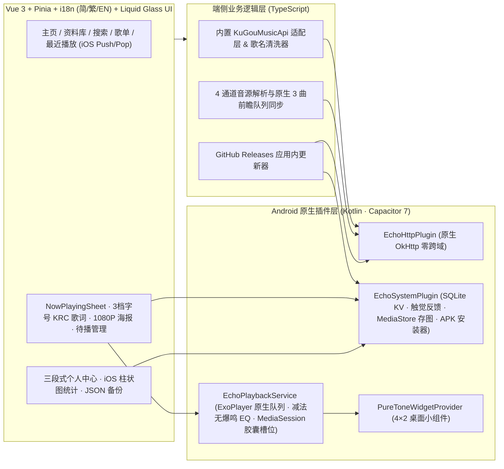

<div align="center">


# PureTone · 纯音

**极简无广告的 iOS 26 液态玻璃（Liquid Glass）美学 Android 音乐播放器**

*纯端侧直连 · 原生息屏连播 · 逐字沉浸歌词 · 听歌洞察柱状图 · 简繁英三语*

<p>
  <a href="https://github.com/xhd2005/puretone/releases/latest">
    
  </a>
  <a href="https://github.com/xhd2005/puretone/actions/workflows/android-build.yml">
    
  </a>
  
  
  <a href="https://www.gnu.org/licenses/gpl-3.0">
    
  </a>
</p>

<p>
  <a href="https://github.com/xhd2005/puretone/releases/latest">📦 下载正式签名 APK</a>
  &nbsp;·&nbsp;
  <a href="#-核心特性">✨ 核心特性</a>
  &nbsp;·&nbsp;
  <a href="#-系统架构">🏗️ 系统架构</a>
  &nbsp;·&nbsp;
  <a href="#-锁屏控制灵动胶囊与后台保活指南">📱 系统播控指南</a>
  &nbsp;·&nbsp;
  <a href="#-作者介绍">👤 作者介绍</a>
  &nbsp;·&nbsp;
  <a href="#-开源合规与完整免责声明">⚖️ 免责声明</a>
</p>

</div>

---

> [!WARNING]
> **仅供个人学习与技术研究**：PureTone（纯音）是一个完全开源、无广告、无商业化、不自建服务器且不托管任何音频文件的本地客户端研究项目。请务必阅读底部的 [开源合规与完整免责声明](#-开源合规与完整免责声明)，支持正版音乐，切勿用于任何商业或非法用途。

---

## ✨ 核心特性

| 模块 | 亮点说明 |
| :--- | :--- |
| **🎨 iOS 26 液态玻璃美学** | 悬浮液态玻璃胶囊底栏、方向感知 iOS Push/Pop 视差切页与 Tab 轻盈淡入、120fps 纯 GPU 自底向上弹簧弹窗、12px 零重叠滚动标题、浅色 / OLED 纯黑深色自适应与双主题强调色。 |
| **🎵 原生 Media3 息屏连播内核** | 基于 Jetpack Media3（ExoPlayer + MediaSession）前台服务：**原生 3 曲前瞻队列**（骑行息屏揣兜不断播、蓝牙耳机 0ms 秒切与弱网自动恢复）、300MB LRU 离线缓存、**0.75x–1.5x 无损倍速**、**零削波专业减法 5 档 EQ**（70ms 柔和切档无爆音）与睡眠定时渐隐。 |
| **🎤 沉浸逐字歌词 & 1080P 海报** | 首帧瞬时定位、3 档歌词字号（标准 / 偏大 / 醒目）、3 秒自动沉浸且滑动即唤出播控、封面双行小歌词预览、双语翻译，以及 **1080P 歌词海报卡片生成**（流光 / 留白 / 黑胶三套模板，一键存相册或系统分享）。 |
| **📊 仿 iOS 屏幕时间听歌洞察** | 本地记录每日与每小时听歌数据，提供 **近 7 天柱状图（含日均虚线）** 与 **今日 24 小时活跃分布**、点按柱体查看明细、Top 5 常听单曲，并支持 **JSON 一键备份与换机恢复（绝不含登录令牌）**。 |
| **📚 千首歌单与待播精修** | 酷狗 v3 分页流式拉满千首大歌单 + SQLite 快照秒开 + 自动剥离 `歌手 - ` 前缀与 `.mp3` 后缀 + 「我喜欢」默认最新添加正序 + 歌单内秒搜 + 右下角「定位当前」+ 左滑快捷「下一首 / 红心」+ 待播清单一键置顶与清空。 |
| **🌐 简繁英完整三语** | 原生支持 **简体中文 / 繁體中文 / English** 跟随系统或应用内一键切换，Android 桌面图标名称同步适配 `纯音` / `純音` / `PureTone`。 |
| **🔄 永久固定签名 & 应用内更新** | 统一 50 年永久固定签名证书，后续版本均支持无损覆盖安装（保留登录状态与全部数据）；内置 GitHub Releases 更新检查器，展示更新日志并应用内直下安装。 |

---

## 🏗️ 系统架构

PureTone 采用 **纯端侧直连架构**，不依赖任何第三方中转后端：所有网络请求、音频解码、前瞻队列、缓存、统计与数据存储均在用户的 Android 设备本地完成。



---

## 📦 下载与安装

1. 前往 **[GitHub Releases](https://github.com/xhd2005/puretone/releases/latest)** 下载正式签名版 `PureTone-vX.Y.Z-release.apk`。
2. 从 `v2.2.1` 起均使用同一把永久固定签名证书，后续升级可直接无损覆盖安装，无需重装或重新登录。
3. 可在 App 内 **「头像 → 偏好设置 → 检查更新」** 自动检测新版本、查阅更新日志并一键下载安装。

---

## 📱 锁屏控制、灵动胶囊与后台保活指南

PureTone 严格遵循 **Android 14–17 标准 Jetpack Media3 规范**（`appCategory="audio"`、`MediaBrowserService`、`IMPORTANCE_DEFAULT` 静音播控渠道、`setMediaButtonPreferences` + `SLOT_FORWARD_SECONDARY` 红心槽位、内嵌高清封面与可拖进度条），广泛适配 Pixel / AOSP、OriginOS、ColorOS、HyperOS、One UI 等主流 Android 系统。

为获得最佳的 **锁屏大封面控制、灵动胶囊显示** 与 **骑行/息屏连播体验**，建议在 App 内 **「偏好设置 → 锁屏与灵动播控」** 快速确认以下两项系统设置：

1. **开启通知与灵动媒体开关**：允许纯音（PureTone）发送通知及锁屏媒体控制；在支持系统级灵动胶囊 / 原子岛 / 流体云的 ROM 中，确认已打开对应媒体播控开关。
2. **设置后台电池不限制（骑行防断播推荐）**：进入系统「应用管理 → 纯音 → 电池 / 耗电管理」，设为 **不受限制 / 允许后台高耗电**，防止息屏状态下系统过度休眠中断后续曲目预解析。

---

## 🛠️ 本地开发与构建

### 环境要求
- Node.js `22+` & pnpm `9+`
- JDK `21`
- Android SDK `35`（Build-Tools `35.0.0`）

### 克隆与运行
```bash
git clone --recursive https://github.com/xhd2005/puretone.git
cd puretone

# 安装依赖
pnpm install

# 类型检查与前端单元测试
pnpm typecheck
pnpm test

# 构建 Web 产物并同步至 Android 工程
pnpm build
npx cap sync android

# 运行 Android 原生单元测试并打包 APK
cd android
./gradlew :app:testDebugUnitTest :app:assembleDebug
```

---

## 👤 作者介绍

- **Hayden Xue**（[@xhd2005](https://github.com/xhd2005)）
- 独立开发者 & 音乐与交互美学爱好者，热衷打磨纯粹、克制、无广告的移动端体验。
- **项目协议**：[GNU General Public License v3.0 (GPL-3.0)](https://www.gnu.org/licenses/gpl-3.0)
- **开源致谢**：特别感谢 [KuGouMusicApi](https://github.com/MakcRe/KuGouMusicApi)、[Jetpack Media3](https://developer.android.com/media/media3)、[Capacitor](https://capacitorjs.com/)、[Vue 3](https://vuejs.org/)、[Tailwind CSS](https://tailwindcss.com/) 与 [Tabler Icons](https://tabler.io/icons) 开源社区。

---

## ⚖️ 开源合规与完整免责声明

请在使用、编译、研究或二次开发本项目源代码前仔细阅读并充分理解以下 7 项条款：

1. **开源学习与绝对非商业定位**：本项目由独立开发者 Hayden Xue (`@xhd2005`) 基于 GNU GPL-3.0 协议开源，仅用于跨平台移动端音频架构、Jetpack Media3 媒体会话与 Liquid Glass 交互美学的技术研究与学习交流。本项目永久无广告、无付费墙、无引流变现，**严禁任何个人、团队或组织将本项目及其衍生作品用于商业盈利、收费分发、捆绑推广或搭建公共在线音乐服务**。
2. **纯端侧直连与零资源托管声明**：PureTone 为完全运行于用户本地终端的客户端软件。开发者**不架设、不运营任何音乐中转或资源服务器，亦不存储、缓存、上传、分发或提供任何受著作权保护的音频、歌词、MV 或封面文件**；所有网络请求均由用户设备自主发起。
3. **知识产权归属与支持正版原则**：软件中检索、呈现及播放的歌曲音频、歌词文本、专辑封面、歌单信息与平台会员权益，其全部著作权、邻接权及商标权均归原音乐平台、唱片公司及合法权利人所有。请尊重音乐人创作成果、**支持正版音乐平台服务**，并在下载编译测试后于 **24 小时内** 从个人设备中清除相关测试产物。
4. **第三方接口与实验性功能风险自担**：登录第三方音乐平台账号、使用实验性跨源音频匹配或签到相关工具均由用户主动触发。因第三方平台接口变更、服务条款（ToS）限制、风控机制或用户自身操作不当引发的账号受限、功能失效、数据丢失或其他后果，均由使用者自行承担。
5. **隐私保护与本地数据边界**：PureTone 绝不收集、统计、上传或向任何第三方传输用户个人身份信息、账号凭据或听歌行为日志。所有登录会话、歌单本地快照与听歌统计仅保存在设备本地应用沙盒内；用户主动导出的 JSON 备份文件亦严格排除所有登录 Cookie 与 Token。
6. **GNU GPL-3.0 许可与“按原样提供（AS-IS）”免责**：本软件依据 GNU GPL-3.0 许可证以“按原样（AS-IS）”方式提供，不附带任何明示或默示的适销性、特定用途适用性或非侵权保证。在适用法律允许的最大范围内，作者及项目贡献者不对因使用或无法使用本软件而产生的任何直接、间接、附带、特殊或衍生损害承担法律责任。
7. **版权权利人通知与 24 小时快速下架通道（DMCA / Takedown）**：我们始终尊重并保护知识产权。若任何音乐平台、著作权人或合法权益方认为本项目中的任何代码引用、接口适配或文档表述侵犯了您的合法权益，请携带权属证明通过本仓库 [GitHub Issues](https://github.com/xhd2005/puretone/issues) 或公开联系方式通知作者，作者将在核实确认后的 **24 小时内** 立即删除或下架相关内容。
