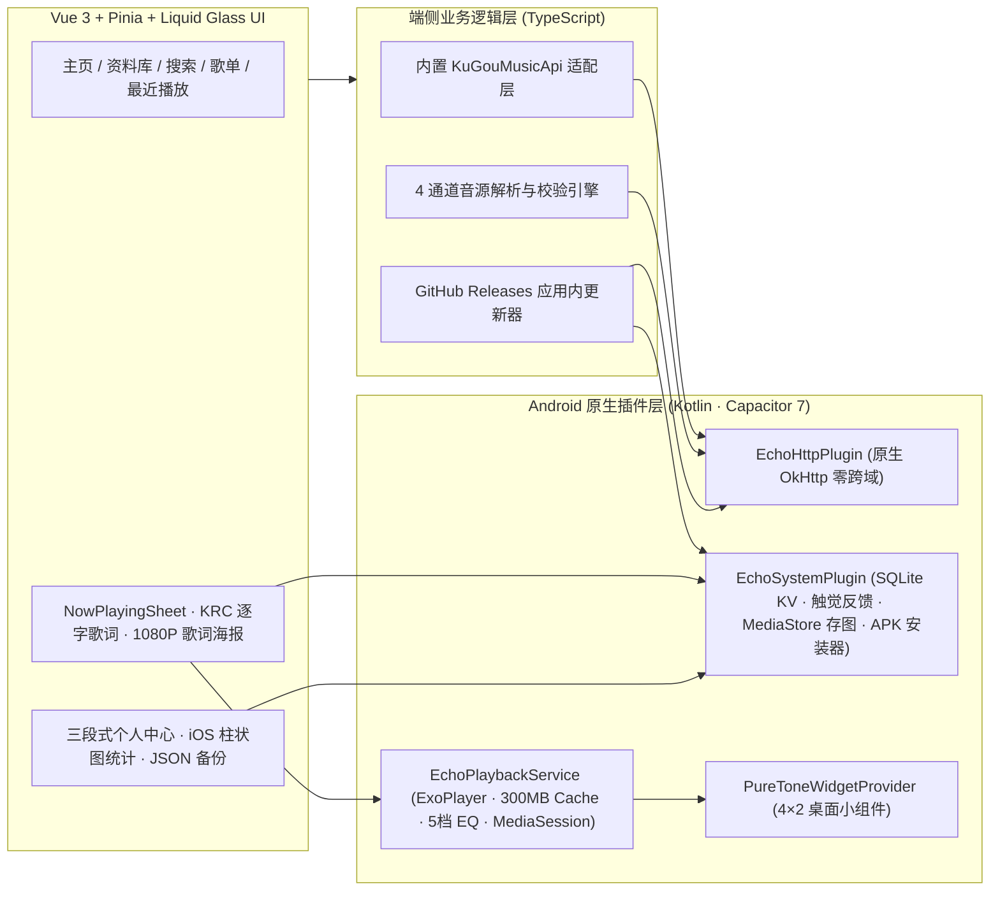

<div align="center">


# PureTone · 纯音

**极简无广告的 iOS 26 液态玻璃（Liquid Glass）美学 Android 音乐播放器**

*本地直连 · 零中转服务器 · 逐字沉浸歌词 · 听歌洞察图表 · Vivo OriginOS 深度适配*

<p>
  <a href="https://github.com/xhd2005/puretone/releases/latest">
    
  </a>
  <a href="https://github.com/xhd2005/puretone/actions/workflows/android-build.yml">
    
  </a>
  
  
  <a href="https://www.gnu.org/licenses/gpl-3.0">
    
  </a>
</p>

<p>
  <a href="https://github.com/xhd2005/puretone/releases/latest">📦 下载最新 APK</a>
  &nbsp;·&nbsp;
  <a href="#-核心特性">✨ 核心特性</a>
  &nbsp;·&nbsp;
  <a href="#-系统架构">🏗️ 系统架构</a>
  &nbsp;·&nbsp;
  <a href="#-vivo-originos-适配指南">📱 Vivo 适配</a>
  &nbsp;·&nbsp;
  <a href="#-开源合规与免责声明">⚖️ 免责声明</a>
</p>

</div>

---

> [!WARNING]
> **仅供个人学习与技术研究**：PureTone（纯音）是一个完全开源、无广告、无商业化、不自建服务器且不托管任何音频文件的本地客户端研究项目。请务必阅读底部的 [开源合规与免责声明](#-开源合规与免责声明)，支持正版音乐，切勿用于任何商业或非法用途。

---

## ✨ 核心特性

| 模块 | 亮点说明 |
| :--- | :--- |
| **🎨 iOS 26 液态玻璃美学** | 悬浮液态玻璃胶囊底栏、退景缩放与 120fps 纯 GPU 自底向上弹簧弹窗、12px 零重叠滚动标题过渡、Apple Music 双列编辑海报卡、浅色 / OLED 纯黑深色自适应与「随封面取色 / 经典苹果红」双主题。 |
| **🎵 原生 Media3 播放内核** | 基于 Jetpack Media3（ExoPlayer + MediaSession）前台服务：300MB LRU 离线音频缓存、220ms 淡入淡出防爆音、耳机断开防外放、**0.75x–1.5x 原生无损倍速**、**5 档原生音频均衡器（EQ）** 与睡眠定时柔和渐隐。 |
| **🎤 沉浸逐字歌词 & 海报** | 首帧瞬时定位、3 秒静置自动沉浸、**滑动歌词即刻唤出播控条**、封面页双行实时小歌词预览、双语翻译切换，以及 **1080P 歌词海报卡片生成**（支持流光渐变 / 极简留白 / 黑胶暗夜三套模板，一键存相册或系统分享）。 |
| **📊 仿 iOS 屏幕时间听歌洞察** | 本地自动记录每日与每小时听歌数据，提供 **近 7 天日柱状图（含日均参考虚线）** 与 **今日 24 小时活跃分布图**，支持点按任意柱体查看明细、最爱歌手与 Top 5 常听单曲，并支持 **JSON 一键备份与换机恢复（绝不含登录令牌）**。 |
| **📚 千首歌单极速体验** | 酷狗 v3 分页流式拉满千首大歌单 + SQLite 本地快照秒开 + 无封面歌单 2×2 拼图 + 「我喜欢」默认最新添加正序 + 歌单内秒搜 + 右下角液态玻璃「定位当前」+ iOS 歌曲行左滑快捷「下一首 / 红心」+ 自动清理 `.mp3/.flac` 后缀。 |
| **📱 Vivo OriginOS 深度适配** | 标准 `appCategory="audio"` 与 `MediaBrowserService` / `MediaButtonReceiver` 注册、封面自适应取色通知、锁屏与通知栏 ❤️ 红心/模式快捷按钮、可选锁屏实时歌词、线性马达微触觉反馈与 4×2 桌面播控小组件。 |
| **🔄 应用内自动更新 & 多号管理** | 内置 GitHub Releases 更新检查器，展示完整更新日志并支持应用内流式下载 APK 直接拉起安装；支持同机扫码/微信登录、多账号独立管理、四档会员到期概览与每日畅听 VIP 签到打卡日历。 |

---

## 🏗️ 系统架构

PureTone 采用 **纯端侧直连架构**，不依赖任何第三方中转后端：所有网络请求、音频解码、缓存、统计与数据存储均在用户的 Android 设备本地完成。



---

## 📦 下载与安装

1. 前往 **[GitHub Releases](https://github.com/xhd2005/puretone/releases/latest)** 下载最新 `app-debug.apk`（或已签名 Release APK）。
2. 在 Android 设备上安装打开；首次启动将展示开源合规告知弹窗。
3. 后续发布新版本后，可在 App 内 **「头像 → 偏好设置 → 关于纯音 → 检查更新」** 查看更新日志并一键下载安装。

---

## 📱 Vivo OriginOS 适配指南

为了让 Vivo / iQOO（OriginOS）发挥最佳的 **顶部原子岛 / 流体云** 与 **锁屏大封面播控** 体验，推荐安装后做一次快速检查（App 内「偏好设置 → Vivo 锁屏与原子岛」已提供一键跳转按钮）：

1. **开启通知与原子岛**：进入系统「设置 → 通知与状态栏 → 原子通知 / 流体云」，确认已开启 **纯音（PureTone）**。
2. **开启锁屏显示**：进入「应用通知管理 → 纯音」，允许锁屏通知与媒体控制显示。
3. **后台播放保活**：进入「应用管理 → 纯音 → 耗电管理」，设为 **允许后台高耗电**，防止息屏播放被系统省电策略误杀。

---

## 🛠️ 本地开发与构建

### 环境要求
- Node.js `22+` & pnpm `9+`
- JDK `21`
- Android SDK `35`（Build-Tools `35.0.0`）

### 克隆与运行
```bash
git clone --recursive https://github.com/xhd2005/puretone.git
cd puretone

# 安装依赖
pnpm install

# 类型检查与前端单元测试
pnpm typecheck
pnpm test

# 构建 Web 产物并同步至 Android 工程
pnpm build
npx cap sync android

# 运行 Android 原生单元测试并打包 Debug APK
cd android
./gradlew :app:testDebugUnitTest :app:assembleDebug
```

打包产物位于：`android/app/build/outputs/apk/debug/app-debug.apk`。

---

## 🤝 致谢与开源协议

- **作者**：[@xhd2005](https://github.com/xhd2005)
- **开源协议**：本项目基于 [GNU General Public License v3.0 (GPL-3.0)](https://www.gnu.org/licenses/gpl-3.0) 协议开源。
- **特别鸣谢**：[KuGouMusicApi](https://github.com/MakcRe/KuGouMusicApi)、[Jetpack Media3](https://developer.android.com/media/media3)、[Capacitor](https://capacitorjs.com/)、[Vue 3](https://vuejs.org/)、[Tailwind CSS](https://tailwindcss.com/) 与 [Tabler Icons](https://tabler.io/icons) 开源社区。

---

## ⚖️ 开源合规与免责声明

请在使用、编译或研究本项目源代码前仔细阅读以下条款：

1. **非商业学习用途**：本项目仅作为个人移动应用开发、UI 动效（Liquid Glass）与 Android Media3 音频架构的技术学习与交流示例，**严禁将本项目或其衍生版本用于任何形式的商业盈利、收费分发、广告变现或搭建公共音频服务**。
2. **不托管任何音频内容**：本项目为纯本地客户端，开发者**不架设、不维护任何音乐资源服务器，亦不存储、上传或传播任何受版权保护的音频、歌词或图片文件**。所有数据均由用户设备在本地发起标准网络请求获取。
3. **尊重正版与第三方权利**：软件中展示及播放的歌曲、封面、歌词及会员权益均归原音乐平台与相关著作权人所有。请尊重音乐人劳动成果，**支持正版音乐**；下载或编译本项目后请于 24 小时内从个人设备中清除测试产物。
4. **账号与合规风险自担**：登录第三方账号、使用音源匹配或签到相关实验性功能均由用户自主触发，相关平台协议合规性及账号安全责任由使用者自行承担；开发者不对因第三方接口变更、封禁或使用不当造成的任何损失负责。
5. **版权通知与快速处理（DMCA / 权利人通道）**：若本项目中的任何代码引用、接口适配或文档内容侵犯了您的合法权益，请通过 GitHub Issues 或仓库联系通道告知并提供权属证明，作者将在确认后的 **24 小时内** 立即删除或下架相关内容。
