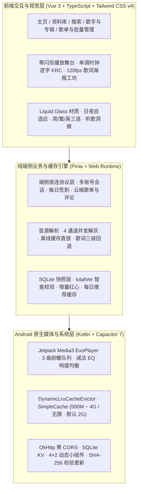

<div align="center">


# 弥音 · MELUNE

**简体中文** · [English](./README.en.md) · [繁體中文](./README.zh-TW.md)

### 音乐终会停止，余音却可以绵延。
*Where Music Becomes Memory.*

极简无广告 · iOS 26 Liquid Glass 美学 · 原生 Media3 音频引擎与 2 GB 离线缓存 · 简/繁/英三语开源 Android 客户端

<p>
  <a href="https://github.com/xhd2005/puretone/releases/latest">
    
  </a>
  <a href="https://github.com/xhd2005/puretone/actions">
    
  </a>
  <a href="https://www.gnu.org/licenses/gpl-3.0">
    
  </a>
  
  
</p>

[📥 下载最新正式版 APK](https://github.com/xhd2005/puretone/releases/latest) · [✨ 核心特性](#features) · [🏗️ 端侧架构](#architecture) · [❓ 上手与 FAQ](#install) · [🙏 特别鸣谢](#thanks) · [⚖️ 合规与免责声明](#disclaimer)

</div>

---

## 🌙 品牌寓意

> **弥**，是绵延，是充盈，也是声音穿越时间后的余韵。  
> **音**，是旋律，是情感，也是每个人独一无二的精神世界。  
> 弥音，希望让每一段旋律都拥有自己的空间，让每一种情绪都能找到共鸣。  
> **MELUNE**（*Melody* × *Lune*）象征旋律与月光——**音乐终会停止，余音却可以绵延。**

弥音坚持**纯粹、克制、永久无广告、纯端侧直连**的产品信条：没有开屏广告，没有信息流推送，没有中转服务器，把整块屏幕与听觉体验完整归还给音乐本身。

---

<a id="features"></a>

## ✨ 核心特性

### 一眼看懂弥音

| 🎧 原生听感 | 💾 智能缓存与离线 | 🎵 探索、歌词与创作 | 💎 美学与工程品质 |
| --- | --- | --- | --- |
| Media3 3 曲前瞻息屏连播 | 默认 **2 GB** 5 档热调缓存 | 零闪烁单调时钟逐字 KRC | iOS 26 Liquid Glass 质感 |
| 余弦淡入淡出无缝切歌 | 弱网 / 飞行模式本地直放 | 120fps 5 模板 1080P 海报 | 日夜自适应与零闪屏开屏 |
| 响度均衡 & 无削波减法 EQ | 版本校验 0 同步秒开「我喜欢」 | 4 模式评论 / 楼中楼 / 点赞 | Android 10–17（含旧版 WebView） |
| 4 通道并发智能换源解灰 | 音频与快照分项透明清理 | 歌手主页 / 专辑 / 云端歌单管理 | 自动检查更新 + 国内多路校验 |

---

### 1. 🎧 聆听与原生音频引擎
- **Jetpack Media3 原生 3 曲前瞻播放队列**：提前将后续 3 首曲目解析写入原生 `ExoPlayer` 播放列表，锁屏骑行、蓝牙耳机切歌（0ms 响应）与户外弱网切换均不断播，弱网中断自动自愈重试。
- **丝滑歌曲过渡（Track Fade）**：单引擎余弦曲线曲末淡出 + 下曲柔和淡入（支持关闭 / `1.5s` / `3s` / `5s`），暂停与恢复同样具备 220ms 柔和包络，零额外耗电。
- **响度均衡（Volume Leveling）与专业无削波减法均衡器（EQ）**：内置 Android `LoudnessEnhancer` 温和拉平不同年代母带响度落差；5 档调音（原声 / 人声 / 低音 / 深夜 / 现场）严格遵循 `<= 0 dB` 减法曲线，切档采用 70ms 柔降 + 120ms 淡入，彻底消除 DSP 爆音与削波失真。
- **内置 4 通道并发解灰与换源锁定**：遇到版权受限或试听片段时自动并行评分匹配原唱高品音源，并支持单曲手动试听与永久锁定偏好音源。

### 2. 💾 2 GB 可调缓存、离线直放与歌单 0 秒秒开
- **5 档热调本地音频缓存（默认 2 GB）**：基于自研 `DynamicLruCacheEvictor` 构建的 Media3 `SimpleCache`，可在偏好设置随时切换 **`500 MB / 1 GB / 2 GB（默认） / 4 GB / 无上限`**，调低上限时后台自动按 LRU 淘汰最久未听曲目，热歌常驻本地。
- **弱网 / 断网无缝离线直放**：在地铁隧道、飞行模式或在线音源超时时，自动检测本地 `SimpleCache` 音频完整性，已缓存曲目 0 流量瞬间起播并标注「本地缓存」。
- **「我喜欢」与歌单智能版本校验**：本地 SQLite 快照记录云端版本号 `totalVer` 与曲目数——未变动时 **0 网络请求、0 转圈瞬间打开上千首大歌单**；其他设备增删曲目时自动增量同步，歌单顶栏亦提供一键手动「刷新同步」。
- **本机红心 / 加歌原地增量更新 & 首页秒开**：播放页点红心或向歌单加/移歌曲后原地更新本地快照并回填最新 `totalVer`，绝不再删除整份快照重拉；首页「每日推荐」与「你的歌单」同步支持 SQLite 持久化秒出与透明分项清理（清音频绝不误删歌单快照、统计与登录状态）。

### 3. 🎵 零闪烁逐字歌词、120fps 海报工坊与深度音乐社区
- **单常驻封面舞台 + 单调时钟逐字 KRC 歌词**：彻底杜绝切页、切歌与播放期歌词闪烁；内置「酷狗 KRC 逐字 + 译文 → 网易云双语 LRC → LRCLIB 国际歌词」三级回退引擎，支持 3 档歌词字号、单曲记忆 `±0.5s / ±1s` 词轴微调与进度条副歌高潮（`song_climax`）微光标记及一键跳转。
- **120fps 直绘 5 模板歌词海报工坊**：提供「月夜玻璃 / 黑胶唱片 / 拍立得 / 电影字幕 / 弥音月色」5 套策展级 1080P 模板，配合 LRU 封面缓存与离屏柔焦，预览切模流畅不卡顿，支持双语译文、日期戳、高清存图与系统分享。
- **完整曲库探索与云端歌单管理**：高清歌手主页（作品/专辑/粉丝统计、简介弹窗、关注、热门与最新页内筛选、合唱多歌手选择器）、专辑详情、4 页签全库搜索与多榜单热搜；支持云端歌单新建、编辑、隐私设置、删除、收藏/取消收藏与底部接管式批量加歌/移歌栏。
- **歌曲「详情 / 评论」双页签互动**：提供推荐 / 最热 / 最新 / 热词 4 模式评论浏览、楼中楼智能清洗去重、百余种酷狗表情原生 Emoji 映射，以及已登录账号实时点赞与回复。

### 4. 💎 Liquid Glass 美学、三语自适应与全机型工程品质
- **月夜流光无缝开屏与日夜一体化设计**：系统启动底色 `#0B1336` 与应用内月光诗意开屏零闪屏衔接；浅色 / 深色 / 跟随系统自然过渡（并配备自动化 `.dark` 根节点可见性安全门禁），附带 iOS 屏幕时间风格听歌洞察图表与多账号自动续期签到日历。
- **Android 16/17 官方 Live Updates & 4×2 动态取色桌面小组件**：规范分离 `EXTRA_COLORIZED` 与 `requestPromotedOngoing` 适配最新系统实时媒体卡片，并提供随封面动态取色的 4×2 桌面播控小组件（含红心联动）。
- **冷启动自动检查更新与国内多路容灾加速**：开屏退场后自动静默检测新版并平滑弹窗（清晰区分「稍后提醒」与「忽略此版本」），内置多组国内加速节点、jsDelivr CDN、自定义镜像前缀与端侧 APK SHA-256 强制校验。
- **Android 10–17 全兼容管线 & 简/繁/英三语**：自研构建期 CSS 降级插件，为 Android 11 / ColorOS 11.1 等旧版 WebView（Chromium 80+）自动展开 `@layer` / `:where()` / `oklch()` / `inset` 与布局属性，确保老机型与旗舰机同样细腻顺滑。

---

<a id="architecture"></a>

## 🏗️ 纯端侧三层架构

弥音采用**完全运行于本机的三层纯客户端架构**，所有协议请求与数据持久化均在您的设备本地完成，不经过任何开发者自建服务器：



---

<a id="install"></a>

## 📥 安装升级与常见问题（FAQ）

### 快速安装
1. 前往 [GitHub Releases](https://github.com/xhd2005/puretone/releases/latest) 下载最新正式版 **`MELUNE-v2.4.9-release.apk`**。
2. 允许安装来源后直接安装即可（若设备已安装任意旧版本弥音 / PureTone，支持 **100% 无损覆盖升级**）。
3. 建议在系统设置中为「弥音 · MELUNE」开启**允许通知**并关闭后台省电限制，以获得最佳息屏连播与锁屏封面体验。

### 常见问题

<details>
<summary><strong>1. 升级新版本会丢失账号登录、歌单快照或听歌统计吗？</strong></summary>

不会。弥音底层永久保留固定包名 `com.xhd2005.puretone` 与 50 年期正式发布签名证书（SHA-256 `89c6ca074542578f6faf341ad1a8f57cbac72f1c89e954fbd3f15756d203a723`），本地构建与 GitHub Actions CI 均使用同一证书。无论跨多少版本直接覆盖安装，登录态、听歌统计、EQ 与缓存均完整保留。
</details>

<details>
<summary><strong>2. 为什么之前打开「我喜欢」要等很久，现在如何保证秒开？</strong></summary>

自 `v2.4.9` 起，弥音在本地 SQLite 快照中记录了云端歌单版本号 `totalVer` 与曲目数。首次同步完成后，只要其他设备未改动歌单，再次打开即为 **0 网络请求瞬间呈现**；在本机点红心或加歌也会原地增量更新快照。如需主动拉取其他设备的改动，轻点歌单右上角 **刷新图标** 即可一键同步。
</details>

<details>
<summary><strong>3. 如何开启 2 GB 离线缓存，清理缓存会删掉歌单和统计吗？</strong></summary>

前往「个人中心 → 偏好设置 → **本地音频智能缓存**」，默认上限为 **2 GB**，可随时点选 `500M / 1G / 2G / 4G / 无限`。播放过的曲目会自动写入本地缓存，断网或地铁弱网时直接离线秒播。设置页已将「本地音频缓存」与「歌单与首页本地快照」完全分开管理，点击任一清理都不会影响您的登录账号、听歌柱状图与偏好设置。
</details>

<details>
<summary><strong>4. 关于 vivo OriginOS 等定制系统顶部原子岛 / 灵动岛的说明</strong></summary>

部分厂商定制 ROM（如 vivo OriginOS 原子岛）对系统级顶部音乐胶囊实施硬编码商业包名白名单，未入选白名单的开源第三方播放器无法直接调用系统私有通道。弥音坚持 100% 开源合规，绝不伪装他人包名或绕过系统限制；推荐在手机桌面添加 **「弥音 4×2 动态小组件」**，同样具备随专辑封面动态取色、切歌与红心联动体验。
</details>

<details>
<summary><strong>5. 换手机时如何安全迁移听歌统计与偏好设置？</strong></summary>

前往「个人中心 → 偏好设置 → **统计与偏好 JSON 备份**」，点击「导出」即可将听歌柱状图数据、EQ、音质、单曲词轴偏移与锁定音源导出为纯文本 JSON（**严格排除所有登录 Cookie 与 Token，绝无凭据泄露风险**），在新手机点击「恢复」粘贴即可完成迁移。
</details>

---

<a id="thanks"></a>

## 🙏 特别鸣谢

弥音 · MELUNE 的每一行代码、每一处动效与每一次稳定迭代，都站在众多卓越开源项目与热心社区伙伴的肩膀之上。在此向以下全部开源项目、维护者与实测伙伴致以最诚挚的谢意：

### 🎵 音乐生态与产品灵感

| 项目 / 社区 | 开源协议 | 贡献与启发 |
| --- | :---: | --- |
| [**MakcRe/KuGouMusicApi**](https://github.com/MakcRe/KuGouMusicApi) | MIT | 提供详尽的酷狗概念版端侧接口协议与加密签名技术参考，是弥音纯端侧直连架构的重要基石。 |
| [**EchoMusic**](https://github.com/EchoMusicApp) | GPL-3.0 | 带来极具启发的移动端极简播放器交互编排、歌手主页结构与纯粹听歌产品美学灵感。 |
| [**LRCLIB**](https://github.com/tranxuanthang/lrclib) | MIT | 开放免费的社区同步歌词数据库，作为弥音歌词三级回退引擎的国际兜底歌词源。 |
| [**UnblockNeteaseMusic**](https://github.com/UnblockNeteaseMusic/server) | LGPL-3.0 | 启发了多源并发候选评分与灰歌无感换源匹配的工程设计思路。 |

### 🤖 Android 原生与音视频基建

| 项目 | 开源协议 | 在弥音中的作用 |
| --- | :---: | --- |
| [**Android Jetpack Media3**](https://github.com/androidx/media) | Apache-2.0 | 驱动原生 `ExoPlayer`、`MediaSessionService`、3 曲前瞻播放队列、`SimpleCache` 动态 LRU 磁盘缓存与锁屏/蓝牙播控。 |
| [**Capacitor**](https://github.com/ionic-team/capacitor) | MIT | 现代 Web-to-Native 原生容器与自定义 Kotlin 插件桥接框架，无缝连接前端交互与原生音频引擎。 |
| [**OkHttp**](https://github.com/square/okhttp) | Apache-2.0 | 支撑零 CORS 原生 HTTP 客户端、ExoPlayer 音频上游数据源与多路镜像 SHA-256 校验下载器。 |
| [**Kotlin**](https://github.com/JetBrains/kotlin) & [**kotlinx.coroutines**](https://github.com/Kotlin/kotlinx.coroutines) | Apache-2.0 | 驱动全部 Android 原生服务、异步高清封面取色与低开销后台磁盘读写。 |
| [**AndroidX**](https://github.com/androidx/androidx) | Apache-2.0 | 通过 `AppCompat`、`Core-KTX`、`SplashScreen` 实现 Android 10–17 边到边安全区与零闪屏启动体验。 |
| [**Google Guava**](https://github.com/google/guava) | Apache-2.0 | 为 Media3 `MediaSession` 异步指令回调与自定义通知按钮提供 `ListenableFuture` 与不可变集合支撑。 |

### 🎨 前端交互、视觉与核心工具库

| 项目 | 开源协议 | 在弥音中的作用 |
| --- | :---: | --- |
| [**Vue 3**](https://github.com/vuejs/core) | MIT | 驱动全部响应式界面、持久化多页签 GPU 舞台与单常驻层零闪烁播放页。 |
| [**Vue Router**](https://github.com/vuejs/router) | MIT | 配合 `KeepAlive` 与方向性推入/弹出转场实现流畅的多层级移动端路由导航。 |
| [**Pinia**](https://github.com/vuejs/pinia) | MIT | 管理多账号会话、播放队列、云端歌单、听歌洞察与持久化偏好状态树。 |
| [**Tailwind CSS v4**](https://github.com/tailwindlabs/tailwindcss) | MIT | 构建整套 iOS 26 Liquid Glass 原子样式系统（结合自研 Android 11 兼容降级插件）。 |
| [**TypeScript**](https://github.com/microsoft/TypeScript) | Apache-2.0 | 为前端业务逻辑、桥接契约与协议解析提供严格静态类型保障。 |
| [**Vite**](https://github.com/vitejs/vite) & [**Vitest**](https://github.com/vitest-dev/vitest) | MIT | 提供极速生产打包、自定义 CSS 构建门禁插件以及 93 项核心回归自动化单元测试。 |
| [**Iconify**](https://github.com/iconify/iconify) & [**Tabler Icons**](https://github.com/tabler/tabler-icons) | MIT | 提供精致统一、按需打包的线性图标视觉体系。 |
| [**pako**](https://github.com/nodeca/pako) | MIT | 纯端侧毫秒级 zlib 解压酷狗加密 KRC 逐字歌词载荷。 |
| [**crypto-js**](https://github.com/brix/crypto-js) & [**node-forge**](https://github.com/digitalbazaar/forge) | MIT / BSD-3-Clause | 支撑跨端纯 JS 签名加密算法与设备身份计算。 |
| [**node-qrcode**](https://github.com/soldair/node-qrcode) | MIT | 本地渲染高清扫码登录二维码。 |
| [**big-integer**](https://github.com/peterolson/BigInteger.js) & [**Axios**](https://github.com/axios/axios) | Unlicense / MIT | 支撑大整数协议运算与端侧零 CORS HTTP 适配层。 |

### 🌐 分发加速与真机测试社区

| 致谢对象 | 贡献与支持 |
| --- | --- |
| [**GitHub Actions**](https://github.com/features/actions) & [**jsDelivr**](https://github.com/jsdelivr/jsdelivr) | 自动化持续集成、永久签名打包发布及全球 CDN 版本清单加速分发。 |
| **国内开源 GitHub 加速镜像生态** | `ghfast`、`gh-proxy`、`akams`、`ghproxy` 等开源镜像节点（配合客户端强制 SHA-256 完整性校验），保障大陆网络环境开箱即用的更新体验。 |
| **真机测试伙伴与早期反馈用户** | 衷心感谢每一位在 **Android 11 / ColorOS 11.1**、**vivo OriginOS**、**小米 HyperOS** 等多款真机上反复实测、截图反馈深色模式、闪烁、动画流畅度、评论楼中楼与歌单缓存细节的朋友和用户——每一次迭代都源于你们的真实声音！ |

---

## 🛠️ 本地构建与开发

```bash
# 1. 安装依赖
pnpm install

# 2. 类型检查、全量前端单元测试（93 项）与生产构建
pnpm typecheck && pnpm test && pnpm build

# 3. 同步至 Android 工程并运行 Kotlin 单元测试与 Release 打包
npx cap sync android
cd android && ./gradlew :app:testDebugUnitTest :app:assembleRelease
```

---

## 👤 作者介绍

**Hayden Xue（[@xhd2005](https://github.com/xhd2005)）**  
独立开发者 & 音乐与交互美学爱好者。秉持克制、纯粹、无广告的设计信条，专注打磨流畅优雅的移动端音频体验与开放源代码实践。

---

<a id="disclaimer"></a>

## ⚖️ 合规与完整免责声明

> **请在使用或下载本软件前完整阅读以下 7 条声明（本软件在首次启动及每次版本更新后均会强制呈现并要求确认）：**

1. **开源学习与绝对非商业定位**：弥音 · MELUNE 由独立开发者 Hayden Xue（@xhd2005）基于 GNU GPL-3.0 协议开源发布，仅面向移动端音频工程、Jetpack Media3 与 Liquid Glass 交互美学技术学习交流。本软件永久无广告、无任何付费墙、引流或商业化变现，严禁任何个人或组织将其或其衍生品用于商业盈利与收费分发。
2. **纯端侧直连与零资源托管声明**：本软件为完全运行于本地设备的纯客户端工具，开发者不架设、不运营任何音乐中转或资源服务器，亦不存储、缓存、上传、分发或提供任何受著作权保护的音频、歌词或封面文件。所有网络请求均由用户设备直接发起。
3. **知识产权归属与支持正版原则**：软件内检索、展示与播放的曲目音频、歌词文本、专辑封面、评论及平台会员权益，其全部知识产权均归属于原音乐平台、唱片公司及合法著作权人所有。请尊重音乐人创作成果、支持正版音乐服务，并在下载测试后于 24 小时内从个人设备中清除测试产物。
4. **第三方接口与实验性功能风险自担**：登录第三方音乐账号、发表评论、关注歌手及使用实验性音源匹配或签到相关功能均由用户自主操作触发。因第三方平台接口变更、服务条款限制、风控策略调整或用户自身不当使用所引发的账号异常、服务中断或其它后果，均由使用者自行承担。
5. **隐私保护与本地数据边界**：弥音 · MELUNE 绝不收集、上报或追踪任何用户个人信息、登录凭据或听歌行为日志。您的账号会话、本地歌单快照与听歌统计完全隔离存储于本机应用沙盒中；导出的 JSON 备份亦严格排除所有登录 Cookie 与 Token。
6. **GPL-3.0 开源许可与“按原样提供”免责**：本软件按 GNU GPL-3.0 许可证“按原样（AS-IS）”提供，不附带任何明示或默示的适销性、特定用途适用性或不侵权担保。在适用法律允许的最大范围内，作者及贡献者不对使用本软件产生的任何直接、间接、附带或衍生损害承担法律责任。
7. **版权权利人通知与 24 小时快速下架通道**：我们高度重视知识产权保护。若任何音乐平台、著作权人或第三方认为本项目的代码引用、接口适配或文档内容侵犯了您的合法权益，请携带权属证明通过 [GitHub Issues](https://github.com/xhd2005/puretone/issues) 或公开联系渠道通知作者，我们将在核实后的 **24 小时内** 立即删除或下架相关内容。
