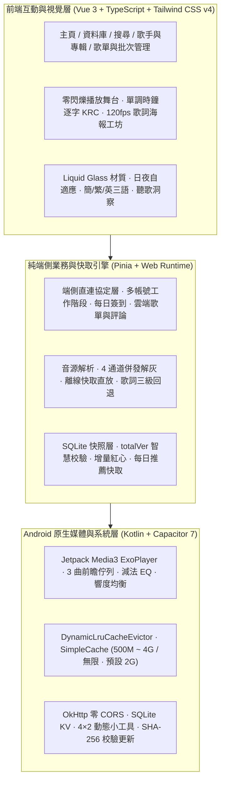

<div align="center">


# 彌音 · MELUNE

[简体中文](./README.md) · [English](./README.en.md) · **繁體中文**

### 音樂終會停止，餘音卻可以綿延。
*Where Music Becomes Memory.*

極簡無廣告 · iOS 26 Liquid Glass 美學 · 原生 Media3 音訊引擎與 2 GB 離線快取 · 簡/繁/英三語開源 Android 音樂用戶端

<p>
  <a href="https://github.com/xhd2005/puretone/releases/latest">
    
  </a>
  <a href="https://github.com/xhd2005/puretone/actions">
    
  </a>
  <a href="https://www.gnu.org/licenses/gpl-3.0">
    
  </a>
  
  
</p>

[📥 下載最新正式版 APK](https://github.com/xhd2005/puretone/releases/latest) · [✨ 核心特性](#features) · [🏗️ 端側架構](#architecture) · [❓ 上手與 FAQ](#install) · [🙏 特別鳴謝](#thanks) · [⚖️ 合規與免責聲明](#disclaimer)

</div>

---

## 🌙 品牌寓意

> **彌**，是綿延，是充盈，也是聲音穿越時間後的餘韻。  
> **音**，是旋律，是情感，也是每個人獨一無二的精神世界。  
> 彌音，希望讓每一段旋律都擁有自己的空間，讓每一種情緒都能找到共鳴。  
> **MELUNE**（*Melody* × *Lune*）象徵旋律與月光——**音樂終會停止，餘音卻可以綿延。**

彌音堅持**純粹、克制、永久無廣告、純端側直連**的產品信條：沒有開屏廣告，沒有資訊流推播，沒有中轉伺服器，把整塊螢幕與聽覺體驗完整歸還給音樂本身。

---

<a id="features"></a>

## ✨ 核心特性

### 一眼看懂彌音

| 🎧 原生聽感 | 💾 智慧快取與離線 | 🎵 探索、歌詞與創作 | 💎 美學與工程品質 |
| --- | --- | --- | --- |
| Media3 3 曲前瞻息屏連播 | 預設 **2 GB** 5 檔熱調快取 | 零閃爍單調時鐘逐字 KRC | iOS 26 Liquid Glass 質感 |
| 餘弦淡入淡出無縫切歌 | 弱網 / 飛航模式本機直放 | 120fps 5 模板 1080P 海報 | 日夜自適應與零閃屏開屏 |
| 響度均衡 & 無削波減法 EQ | 版本校驗 0 同步秒開歌單 | 4 模式評論 / 樓中樓 / 按讚 | Android 10–17（含舊版 WebView） |
| 4 通道併發智慧換源解灰 | 音訊與快照分項透明清理 | 歌手主頁 / 專輯 / 雲端歌單管理 | 自動檢查更新 + 多路加速校驗 |

---

### 1. 🎧 聆聽與原生音訊引擎
- **Jetpack Media3 原生 3 曲前瞻播放佇列**：提前將後續 3 首曲目解析寫入原生 `ExoPlayer` 播放清單，鎖屏騎行、藍牙耳機切歌（0ms 響應）與戶外弱網切換均不斷播，弱網中斷自動自癒重試。
- **絲滑歌曲過渡（Track Fade）**：單引擎餘弦曲線曲末淡出 + 下曲柔和淡入（支援關閉 / `1.5s` / `3s` / `5s`），暫停與恢復亦具備 220ms 柔和包絡，零額外耗電。
- **響度均衡（Volume Leveling）與專業無削波減法均衡器（EQ）**：內建 Android `LoudnessEnhancer` 溫和拉平不同年代母帶響度落差；5 檔調音（原聲 / 人聲 / 低音 / 深夜 / 現場）嚴格遵循 `<= 0 dB` 減法曲線，切檔採用 70ms 柔降 + 120ms 淡入，徹底消除 DSP 爆音與削波失真。
- **內建 4 通道併發解灰與換源鎖定**：遇到版權受限或試聽片段時自動平行評分配對原唱高品音源，並支援單曲手動試聽與永久鎖定偏好音源。

### 2. 💾 2 GB 可調快取、離線直放與歌單 0 秒秒開
- **5 檔熱調本機音訊快取（預設 2 GB）**：基於自研 `DynamicLruCacheEvictor` 建構的 Media3 `SimpleCache`，可於偏好設定隨時切換 **`500 MB / 1 GB / 2 GB（預設） / 4 GB / 無上限`**，調低上限時背景自動按 LRU 淘汰最久未聽曲目，熱歌常駐本機。
- **弱網 / 斷網無縫離線直放**：在地鐵隧道、飛航模式或線上音源逾時時，自動偵測本機 `SimpleCache` 音訊完整性，已快取曲目 0 流量瞬間起播並自動切換至本機快取通道。
- **「我喜歡的音樂」與歌單智慧版本校驗**：本機 SQLite 快照記錄雲端版本號 `totalVer` 與曲目數——未變動時 **0 網路請求、0 轉圈瞬間開啟上千首大歌單**；其他裝置增刪曲目時自動同步，歌單頂欄亦提供一鍵手動「重新整理」。
- **本機紅心 / 加歌原地增量更新 & 主頁秒開**：播放頁點紅心或向歌單加/移歌曲後原地更新本機快照並回填最新 `totalVer`，不再刪除整份快照重拉；主頁「每日推薦」與「你的歌單」同步支援 SQLite 持久化秒出與透明分項清理（清音訊絕不誤刪歌單快照、統計與登入狀態）。

### 3. 🎵 零閃爍逐字歌詞、120fps 海報工坊與深度音樂社群
- **單常駐封面舞台 + 單調時鐘逐字 KRC 歌詞**：徹底杜絕切頁、切歌與播放期歌詞閃爍；內建「酷狗 KRC 逐字 + 譯文 → 網易雲雙語 LRC → LRCLIB 國際歌詞」三級回退引擎，支援 3 檔歌詞字號、單曲記憶 `±0.5s / ±1s` 詞軸微調與進度條副歌高潮（`song_climax`）微光標記及一鍵跳轉。
- **120fps 直繪 5 模板歌詞海報工坊**：提供「月夜玻璃 / 黑膠唱片 / 拍立得 / 電影字幕 / 彌音月色」5 套策展級 1080P 模板，配合 LRU 封面快取與離屏柔焦，預覽切模流暢不卡頓，支援雙語譯文、日期戳、高清存圖與系統分享。
- **完整曲庫探索與雲端歌單管理**：高清歌手主頁（作品/專輯/粉絲統計、簡介彈窗、關注、熱門與最新頁內篩選、合唱多歌手選擇器）、專輯詳情、4 頁籤全庫搜尋與多榜單熱搜；支援雲端歌單新建、編輯、隱私設定、刪除、收藏/取消收藏與底部接管式批次加歌/移歌列。
- **歌曲「詳情 / 評論」雙頁籤互動**：提供推薦 / 最熱 / 最新 / 熱詞 4 模式評論瀏覽、樓中樓智慧清洗去重、百餘種表情原生 Emoji 映射，以及已登入帳號即時按讚與回覆。

### 4. 💎 Liquid Glass 美學、三語自適應與全機型工程品質
- **月夜流光無縫開屏與日夜一體化設計**：系統啟動底色 `#0B1336` 與應用內月光詩意開屏零閃屏銜接；淺色 / 深色 / 跟隨系統自然過渡（並配備自動化 `.dark` 根節點可見性安全門禁），附帶 iOS 螢幕使用時間風格聽歌洞察圖表與多帳號自動續期簽到日曆。
- **Android 16/17 官方 Live Updates & 4×2 動態取色桌面小工具**：規範分離 `EXTRA_COLORIZED` 與 `requestPromotedOngoing` 適配最新系統即時媒體卡片，並提供隨封面動態取色的 4×2 桌面播控小工具（含紅心聯動）。
- **冷啟動自動檢查更新與多路容災加速**：開屏退場後自動靜默偵測新版並平滑彈窗（清晰區分「稍後提醒」與「忽略此版本」），內建多組加速節點、jsDelivr CDN、自訂鏡像前綴與端側 APK SHA-256 強制校驗。
- **Android 10–17 全相容管線 & 簡/繁/英三語**：自研建置期 CSS 降級外掛，為 Android 11 / ColorOS 11.1 等舊版 WebView（Chromium 80+）自動展開 `@layer` / `:where()` / `oklch()` / `inset` 與版面屬性，確保老機型與旗艦機同樣細膩順滑。

---

<a id="architecture"></a>

## 🏗️ 純端側三層架構

彌音採用**完全執行於本機的三層純用戶端架構**，所有協定請求與資料持久化均於您的裝置本機完成，不經過任何開發者自建伺服器：



---

<a id="install"></a>

## 📥 安裝升級與常見問題（FAQ）

### 快速安裝
1. 前往 [GitHub Releases](https://github.com/xhd2005/puretone/releases/latest) 下載最新正式版 **`MELUNE-v2.4.9-release.apk`**。
2. 允許安裝來源後直接安裝即可（若裝置已安裝任意舊版本彌音 / PureTone，支援 **100% 無損覆蓋升級**）。
3. 建議在系統設定中為「彌音 · MELUNE」開啟**允許通知**並關閉背景省電限制，以獲得最佳息屏連播與鎖屏封面體驗。

### 常見問題

<details>
<summary><strong>1. 升級新版本會遺失帳號登入、歌單快照或聽歌統計嗎？</strong></summary>

不會。彌音底層永久保留固定包名 `com.xhd2005.puretone` 與 50 年期正式發布簽章憑證（SHA-256 `89c6ca074542578f6faf341ad1a8f57cbac72f1c89e954fbd3f15756d203a723`），本機建置與 GitHub Actions CI 均使用同一憑證。無論跨多少版本直接覆蓋安裝，登入態、聽歌統計、EQ 與快取均完整保留。
</details>

<details>
<summary><strong>2. 為什麼之前開啟「我喜歡的音樂」要等很久，現在如何保證秒開？</strong></summary>

自 `v2.4.9` 起，彌音於本機 SQLite 快照中記錄了雲端歌單版本號 `totalVer` 與曲目數。首次同步完成後，只要其他裝置未改動歌單，再次開啟即為 **0 網路請求瞬間呈現**；於本機點紅心或加歌亦會原地增量更新快照。如需主動拉取其他裝置的改動，輕點歌單右上角 **重新整理圖示** 即可一鍵同步。
</details>

<details>
<summary><strong>3. 如何調整 2 GB 離線快取，清理快取會刪掉歌單和統計嗎？</strong></summary>

前往「個人中心 → 偏好設定 → **本機音訊智慧快取**」，預設上限為 **2 GB**，可隨時點選 `500M / 1G / 2G / 4G / 無限`。播放過的曲目會自動寫入本機快取，斷網或地鐵弱網時直接離線秒播。設定頁已將「本機音訊快取」與「歌單與主頁本機快照」完全分開管理，點擊任一清理都不會影響您的登入帳號、聽歌柱狀圖與偏好設定。
</details>

<details>
<summary><strong>4. 關於 vivo OriginOS 等客製系統頂部原子島 / 靈動島的說明</strong></summary>

部分廠商客製 ROM（如 vivo OriginOS 原子島）對系統級頂部音樂膠囊實施硬編碼商業包名白名單，未入選白名單的開源第三方播放器無法直接呼叫系統私有通道。彌音堅持 100% 開源合規，絕不偽裝他人包名或繞過系統限制；推薦於手機桌面加入 **「彌音 4×2 動態小工具」**，同樣具備隨專輯封面動態取色、切歌與紅心聯動體驗。
</details>

<details>
<summary><strong>5. 換手機時如何安全遷移聽歌統計與偏好設定？</strong></summary>

前往「個人中心 → 偏好設定 → **統計與偏好 JSON 備份**」，點擊「匯出」即可將聽歌柱狀圖資料、EQ、音質、單曲詞軸偏移與鎖定音源匯出為純文字 JSON（**嚴格排除所有登入 Cookie 與 Token，絕無憑證外洩風險**），在新手機點擊「還原」貼上即可完成遷移。
</details>

---

<a id="thanks"></a>

## 🙏 特別鳴謝

彌音 · MELUNE 的每一行程式碼、每一處動效與每一次穩定迭代，都站在眾多卓越開源專案與熱心社群夥伴的肩膀之上。在此向以下全部開源專案、維護者與實測夥伴致上最誠摯的謝意：

### 🎵 音樂生態與產品靈感

| 專案 / 社群 | 開源協議 | 貢獻與啟發 |
| --- | :---: | --- |
| [**MakcRe/KuGouMusicApi**](https://github.com/MakcRe/KuGouMusicApi) | MIT | 提供詳盡的酷狗概念版端側介面協定與加密簽章技術參考，是彌音純端側直連架構的重要基石。 |
| [**EchoMusic**](https://github.com/EchoMusicApp) | GPL-3.0 | 帶來極具啟發的行動端極簡播放器互動編排、歌手主頁結構與純粹聽歌產品美學靈感。 |
| [**LRCLIB**](https://github.com/tranxuanthang/lrclib) | MIT | 開放免費的社群同步歌詞資料庫，作為彌音歌詞三級回退引擎的國際兜底歌詞源。 |
| [**UnblockNeteaseMusic**](https://github.com/UnblockNeteaseMusic/server) | LGPL-3.0 | 啟發了多源併發候選評分與灰歌無感換源配對的工程設計思路。 |

### 🤖 Android 原生與音視訊基建

| 專案 | 開源協議 | 在彌音中的作用 |
| --- | :---: | --- |
| [**Android Jetpack Media3**](https://github.com/androidx/media) | Apache-2.0 | 驅動原生 `ExoPlayer`、`MediaSessionService`、3 曲前瞻播放佇列、`SimpleCache` 動態 LRU 磁碟快取與鎖屏/藍牙播控。 |
| [**Capacitor**](https://github.com/ionic-team/capacitor) | MIT | 現代 Web-to-Native 原生容器與自訂 Kotlin 外掛橋接框架，無縫連接前端互動與原生音訊引擎。 |
| [**OkHttp**](https://github.com/square/okhttp) | Apache-2.0 | 支撐零 CORS 原生 HTTP 用戶端、ExoPlayer 音訊上游資料來源與多路鏡像 SHA-256 校驗下載器。 |
| [**Kotlin**](https://github.com/JetBrains/kotlin) & [**kotlinx.coroutines**](https://github.com/Kotlin/kotlinx.coroutines) | Apache-2.0 | 驅動全部 Android 原生服務、非同步高清封面取色與低開銷背景磁碟讀寫。 |
| [**AndroidX**](https://github.com/androidx/androidx) | Apache-2.0 | 透過 `AppCompat`、`Core-KTX`、`SplashScreen` 實現 Android 10–17 邊到邊安全區與零閃屏啟動體驗。 |
| [**Google Guava**](https://github.com/google/guava) | Apache-2.0 | 為 Media3 `MediaSession` 非同步指令回呼與自訂通知按鈕提供 `ListenableFuture` 與不可變集合支撐。 |

### 🎨 前端互動、視覺與核心工具庫

| 專案 | 開源協議 | 在彌音中的作用 |
| --- | :---: | --- |
| [**Vue 3**](https://github.com/vuejs/core) | MIT | 驅動全部響應式介面、持久化多頁籤 GPU 舞台與單常駐層零閃爍播放頁。 |
| [**Vue Router**](https://github.com/vuejs/router) | MIT | 配合 `KeepAlive` 與方向性推入/彈出轉場實現流暢的多層級行動端路由導覽。 |
| [**Pinia**](https://github.com/vuejs/pinia) | MIT | 管理多帳號工作階段、播放佇列、雲端歌單、聽歌洞察與持久化偏好狀態樹。 |
| [**Tailwind CSS v4**](https://github.com/tailwindlabs/tailwindcss) | MIT | 建構整套 iOS 26 Liquid Glass 原子樣式系統（結合自研 Android 11 相容降級外掛）。 |
| [**TypeScript**](https://github.com/microsoft/TypeScript) | Apache-2.0 | 為前端業務邏輯、橋接契約與協定解析提供嚴格靜態型別保障。 |
| [**Vite**](https://github.com/vitejs/vite) & [**Vitest**](https://github.com/vitest-dev/vitest) | MIT | 提供極速生產打包、自訂 CSS 建置門禁外掛以及 93 項核心回歸自動化單元測試。 |
| [**Iconify**](https://github.com/iconify/iconify) & [**Tabler Icons**](https://github.com/tabler/tabler-icons) | MIT | 提供精緻統一、按需打包的線性圖示視覺體系。 |
| [**pako**](https://github.com/nodeca/pako) | MIT | 純端側毫秒級 zlib 解壓酷狗加密 KRC 逐字歌詞載荷。 |
| [**crypto-js**](https://github.com/brix/crypto-js) & [**node-forge**](https://github.com/digitalbazaar/forge) | MIT / BSD-3-Clause | 支撐跨端純 JS 簽章加密演算法與裝置身分計算。 |
| [**node-qrcode**](https://github.com/soldair/node-qrcode) | MIT | 本機繪製高清掃碼登入 QR Code。 |
| [**big-integer**](https://github.com/peterolson/BigInteger.js) & [**Axios**](https://github.com/axios/axios) | Unlicense / MIT | 支撐大整數協定運算與端側零 CORS HTTP 適配層。 |

### 🌐 分發加速與真機測試社群

| 致謝對象 | 貢獻與支持 |
| --- | --- |
| [**GitHub Actions**](https://github.com/features/actions) & [**jsDelivr**](https://github.com/jsdelivr/jsdelivr) | 自動化持續整合、永久簽章打包發布及全球 CDN 版本清單加速分發。 |
| **開源 GitHub 加速鏡像生態** | `ghfast`、`gh-proxy`、`akams`、`ghproxy` 等開源鏡像節點（配合用戶端強制 SHA-256 完整性校驗），保障多網路環境開箱即用的更新體驗。 |
| **真機測試夥伴與早期回饋用戶** | 衷心感謝每一位在 **Android 11 / ColorOS 11.1**、**vivo OriginOS**、**小米 HyperOS** 等多款真機上反覆實測、截圖回饋深色模式、閃爍、動畫流暢度、評論樓中樓與歌單快取細節的朋友和用戶——每一次迭代都源於你們的真實聲音！ |

---

## 🛠️ 本機建置與開發

```bash
# 1. 安裝相依套件
pnpm install

# 2. 型別檢查、全量前端單元測試（93 項）與生產建置
pnpm typecheck && pnpm test && pnpm build

# 3. 同步至 Android 專案並執行 Kotlin 單元測試與 Release 打包
npx cap sync android
cd android && ./gradlew :app:testDebugUnitTest :app:assembleRelease
```

---

## 👤 作者介紹

**Hayden Xue（[@xhd2005](https://github.com/xhd2005)）**  
獨立開發者 & 音樂與互動美學愛好者。秉持克制、純粹、無廣告的設計信條，專注打磨流暢優雅的行動端音訊體驗與開放原始碼實踐。

---

<a id="disclaimer"></a>

## ⚖️ 合規與完整免責聲明

> **請在使用或下載本軟體前完整閱讀以下 7 條聲明（本軟體在首次啟動及每次版本更新後均會強制呈現並要求確認）：**

1. **開源學習與絕對非商業定位**：彌音 · MELUNE 由獨立開發者 Hayden Xue（@xhd2005）基於 GNU GPL-3.0 協議開源發布，僅供行動端音訊工程、Jetpack Media3 與 Liquid Glass 互動美學技術學習交流。本軟體永久無廣告、無任何付費牆或商業變現，嚴禁任何個人或組織將其或其衍生品用於商業營利與收費分發。
2. **純端側直連與零資源託管聲明**：本軟體為完全執行於本機裝置的純用戶端工具，開發者不架設、不營運任何音樂中轉或資源伺服器，亦不儲存、快取、上傳、分發或提供任何受著作權保護的音訊、歌詞或封面檔案。所有網路請求均由使用者裝置直接發起。
3. **智慧財產權歸屬與支持正版原則**：軟體內檢索、展示與播放的曲目音訊、歌詞文本、專輯封面、評論及平台會員權益，其全部智慧財產權均歸屬於原音樂平台、唱片公司及合法著作權人所有。請尊重音樂人創作成果、支持正版音樂服務，並在下載測試後於 24 小時內從個人裝置中清除測試產物。
4. **第三方介面與實驗性功能風險自負**：登入第三方音樂帳號、發表評論、關注歌手及使用實驗性音源配對或簽到相關功能均由使用者自主操作觸發。因第三方平台介面變更、服務條款限制、風控策略調整或使用者自身不當使用所引發的帳號異常、服務中斷或其他後果，均由使用者自行承擔。
5. **隱私保護與本機資料邊界**：彌音 · MELUNE 絕不蒐集、上報或追蹤任何使用者個人資訊、登入憑證或聽歌行為日誌。您的帳號工作階段、本機歌單快照與聽歌統計完全隔離儲存於本機應用沙盒中；匯出的 JSON 備份亦嚴格排除所有登入 Cookie 與 Token。
6. **GPL-3.0 開源授權與「按原樣提供」免責**：本軟體按 GNU GPL-3.0 授權條款「按原樣（AS-IS）」提供，不附帶任何明示或默示的適銷性、特定用途適用性或不侵權擔保。在適用法律允許的最大範圍內，作者及貢獻者不對使用本軟體產生的任何直接、間接、附帶或衍生損害承擔法律責任。
7. **版權權利人通知與 24 小時快速下架通道**：我們高度重視智慧財產權保護。若任何音樂平台、著作權人或第三方認為本專案的程式碼引用、介面適配或文件內容侵犯了您的合法權益，請攜帶權屬證明透過 [GitHub Issues](https://github.com/xhd2005/puretone/issues) 或公開聯絡管道通知作者，我們將在核實後的 **24 小時內** 立即刪除或下架相關內容。
